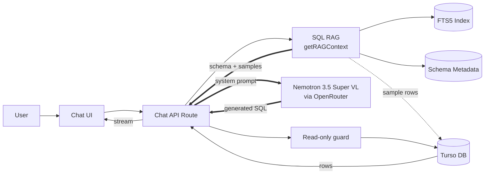

# QueryMind

Ask a question about a database in plain English. QueryMind retrieves the relevant schema, writes SQLite, runs it through a read-only guard, and answers in business language.

Live demo: [chat-sql-agent.vercel.app](https://chat-sql-agent.vercel.app)

The demo database is a seeded e-commerce and SaaS schema with 24 tables and about 8,335 rows.

---

## What it does

- **Natural language to SQL.** A question becomes a SQL query, a result table, and a plain-English answer.
- **Schema retrieval with FTS5.** A full-text search over table descriptions picks the tables that match the question. No embeddings, no vector store.
- **Sample rows in context.** Each retrieved table includes a few real rows, so the model sees actual values and casing.
- **Dry Run mode.** Generate SQL without running it.
- **Read-only guard.** The server accepts a single `SELECT` or read-only `WITH` statement and rejects DDL and DML keywords.
- **Database guide.** An in-app panel lists every table and a set of example questions.

---

## How it works

1. You ask a question.
2. `lib/sql-rag.ts` removes stop words, searches the `schema_metadata_fts` index, and returns the top matching tables.
3. For each table it adds the description, column types, relationships, and three sample rows to the system prompt.
4. The model writes SQL and calls the `db` tool.
5. `assertSafeReadOnlyQuery` checks the statement before it reaches the database.
6. The result returns to the UI as a SQL card and a plain-English answer.
7. In Dry Run mode the tool is removed, so the model can only return SQL.



---

## Tech stack

| Layer | Technology |
| --- | --- |
| Framework | Next.js 16, App Router |
| AI SDK | `ai` and `@ai-sdk/react` |
| Model | `nvidia/nemotron-3.5-super-vl:free` via OpenRouter |
| Database | Turso, libSQL/SQLite |
| ORM and migrations | Drizzle ORM and `drizzle-kit` |
| Retrieval | SQLite FTS5 over a `schema_metadata` table |
| UI | React 19, Tailwind CSS v4, Radix primitives, `react-markdown` |
| Seed data | `@faker-js/faker`, 24 tables, about 8,335 rows |

---

## Getting started

You need Node.js 20.9 or newer, a [Turso](https://turso.tech) database, and an [OpenRouter](https://openrouter.ai/keys) API key.

```bash
git clone https://github.com/darshil-here/chat-sql-agent.git
cd chat-sql-agent
npm install
cp .env.example .env.local
```

Fill in the three values in `.env.local`:

```bash
OPENROUTER_API_KEY=your-openrouter-key
TURSO_DATABASE_URL=libsql://your-database.turso.io
TURSO_AUTH_TOKEN=your-turso-token
```

Create the schema, seed the data, and build the FTS index. Run this once on a fresh database.

```bash
npm run db:setup
```

Start the app:

```bash
npm run dev
```

Open [http://localhost:3000](http://localhost:3000). The chat is at `/chat`.

### Scripts

| Command | What it does |
| --- | --- |
| `npm run dev` | Start the development server |
| `npm run build` | Production build |
| `npm run lint` | Run ESLint |
| `npm run db:setup` | Apply migrations, seed data, seed metadata, rebuild FTS |
| `npm run db:generate` | Generate a Drizzle migration |
| `npm run db:migrate` | Apply Drizzle migrations |
| `npm run db:seed` | Reseed the demo data |
| `npm run db:studio` | Open Drizzle Studio |
| `npx tsx scripts/test-rag.ts "question"` | Inspect the tables a question retrieves |

---

## Project structure

```
app/
  api/chat/route.ts      Chat endpoint, system prompt, SQL guard
  chat/page.tsx          Chat UI
  page.tsx               Landing page
components/
  chat/                  Composer, messages, SQL card, database guide
  ui/                    Small Radix and Tailwind primitives
db/
  schema.ts              24 table definitions plus schema_metadata
  db.seed.ts             Faker seed script
  migrations/            Drizzle migrations
lib/
  sql-rag.ts             FTS5 retrieval and sample rows
scripts/
  setup-sql-rag.ts       One-shot database setup
  seed-schema-metadata.ts
  test-rag.ts
evals/
  questions.json         Seed questions for the evaluation set
```

---

## Design notes

**Why FTS5 instead of embeddings.** The search corpus is 24 table descriptions, not a document collection. A keyword index is enough to map "revenue" or "invoices" to a table, and it adds no embedding model, no vector database, and no extra network call. The tradeoff is that FTS5 does not understand synonyms. The retrieval code handles that with stop words and an `AND` then `OR` fallback.

**Why the guard runs on the server.** The system prompt tells the model to write `SELECT` only. A prompt is not an enforcement mechanism, so the route checks every statement again before it reaches Turso. This is defense in depth, not a replacement for a read-only database user.

**Why Dry Run exists.** Generated SQL is still generated SQL. Dry Run lets you inspect the query before it runs, which helps during demos and debugging.

**Scope.** This is a portfolio project with seeded data, not a production database tool. The interesting parts are the retrieval step, the prompt, and the guard. The UI is deliberately small.

---

## Limitations

- The demo data comes from faker. It looks realistic but it is not a real business dataset.
- FTS5 matches keywords, not meaning. A question that uses a different word for the same concept can miss the right table. This is the main accuracy bottleneck.
- The chat route has no authentication and no rate limit yet. Add one before exposing it publicly.
- Generated SQL should be reviewed before it runs against real data. Use Dry Run, and use a read-only database user in production.
