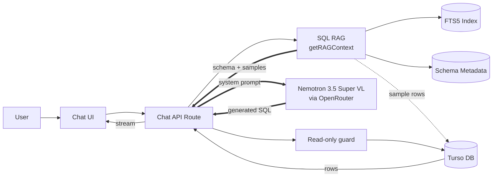

# QueryMind

Ask a question about a database in plain English. QueryMind retrieves the relevant schema, writes SQLite, runs it through a read-only guard, and answers in business language.

Live demo: [chat-sql-agent.vercel.app](https://chat-sql-agent.vercel.app)

The demo database is a seeded e-commerce and SaaS schema with 24 tables and about 9,200 rows.

---

## What it does

- **Natural language to SQL.** A question becomes a SQL query, a result table, and a plain-English answer.
- **Schema grounding with FTS5.** The full 24-table schema is always in the prompt. FTS5 and table-name matching pick which tables get sample rows. No embeddings, no vector store.
- **Sample rows in context.** The top five matching tables include a few real rows, so the model sees actual values and casing.
- **Dry Run mode.** Generate SQL without running it.
- **Read-only guard.** The server accepts a single `SELECT` or read-only `WITH` statement and rejects DDL and DML keywords.
- **Database guide.** An in-app panel lists every table and a set of example questions.

---

## How it works

1. You ask a question.
2. The chat route keeps the last three user turns. `lib/sql-rag.ts` boosts tables whose names match the keywords and uses FTS5 to rank the rest.
3. The full schema for every table goes into the system prompt. The top five tables also get three sample rows.
4. The model writes SQL and calls the `db` tool.
5. `lib/db-query.ts` sends every statement through the guard, runs it, and caps the result.
6. The result returns to the UI as a SQL card and a plain-English answer. Tool output is capped at 200 rows.
7. In Dry Run mode the tool is removed, so the model can only return SQL.



---

## Tech stack

| Layer | Technology |
| --- | --- |
| Framework | Next.js 16, App Router |
| AI SDK | `ai` and `@ai-sdk/react` |
| Model | `nvidia/nemotron-3.5-super-vl:free` via OpenRouter |
| Database | Turso, libSQL/SQLite |
| ORM and migrations | Drizzle ORM and `drizzle-kit` |
| Retrieval | SQLite FTS5 over a `schema_metadata` table |
| UI | React 19, Tailwind CSS v4, Radix primitives, `react-markdown` |
| Seed data | `@faker-js/faker`, 24 tables, about 9,200 rows |

---

## Evaluation

`npm run eval` runs the 20 questions in `evals/questions.json` against the retrieval layer.

**Current score: 20/20 retrieval recall.**

The check is whether every expected table lands in the top five tables that get sample rows. It is a regression test for retrieval, not a score of the model's final prose.

The SQL guard, the query wrapper, the catalog and the prompts have a small test suite too:

```bash
npm test
```

---

## Getting started

You need Node.js 24.22.2 (Node 24 LTS, see `.nvmrc`), a [Turso](https://turso.tech) database, and an [OpenRouter](https://openrouter.ai/keys) API key.

```bash
git clone https://github.com/darshil-here/chat-sql-agent.git
cd chat-sql-agent
npm install
cp .env.example .env.local
```

Fill in the three values in `.env.local`:

```bash
OPENROUTER_API_KEY=your-openrouter-key
TURSO_DATABASE_URL=libsql://your-database.turso.io
TURSO_AUTH_TOKEN=your-turso-token
```

Create the schema, seed the data, and build the FTS index. Run this once on a fresh database.

```bash
npm run db:setup
```

Start the app:

```bash
npm run dev
```

Open [http://localhost:3000](http://localhost:3000). The chat is at `/chat`.

### Scripts

| Command | What it does |
| --- | --- |
| `npm run dev` | Start the development server |
| `npm run build` | Production build |
| `npm run lint` | Run ESLint |
| `npm run db:setup` | Apply migrations, seed data, write the retrieval catalog |
| `npm run db:generate` | Generate a Drizzle migration |
| `npm run db:migrate` | Apply Drizzle migrations |
| `npm run db:seed` | Reseed the demo data and the retrieval catalog |
| `npm run db:studio` | Open Drizzle Studio |
| `npm run eval` | Run the retrieval evaluation |
| `npm test` | Run the guard, query, catalog and prompt tests |
| `npx tsx scripts/preview-context.ts "question"` | Inspect the context a question retrieves |

---

## Project structure

```
app/
  api/chat/route.ts      Chat endpoint: validation, instructions, db tool
  chat/page.tsx          Chat shell (state and layout)
  page.tsx               Landing page
components/
  chat/                  Composer, conversation, SQL card, database guide
  landing/               Landing page link
  ui/                    Small Radix and Tailwind primitives
db/
  schema.ts              24 table definitions plus schema_metadata
  catalog.ts             Table docs, guide groups, value domains, example questions
  seed.ts                Faker seed data
  seed-catalog.ts        Writes the catalog into schema_metadata for FTS
  client.ts              Turso client and env loading
  migrations/            Drizzle migrations
lib/
  sql-rag.ts             Schema context and sample rows
  sql-guard.ts           SELECT-only guard
  db-query.ts            Guard, execute and cap every query
  chat-contract.ts       Tool name, input schema, row cap, UI types
  prompts.ts             System prompt for run and dry-run modes
  env.ts                 .env.local loading and required variables
scripts/
  setup.ts               Migrate and seed
  seed.ts                Reseed data and catalog
  eval-retrieval.ts      Retrieval evaluation
  preview-context.ts     Inspect the retrieval context
evals/
  questions.json         Evaluation questions
tests/
  *.test.ts              Guard, query, catalog and prompt checks
```

---

## Design notes

**Why FTS5 instead of embeddings.** The search corpus is 24 table descriptions, not a document collection. A keyword index is enough to pick which tables get sample rows, and it adds no embedding model, no vector database, and no extra network call. The full schema is only about 2.6k tokens, so a retrieval miss costs more than the tokens saved. Every table is always included. FTS5 and table-name matching decide which five tables get sample data. The tradeoff is that FTS5 does not understand synonyms, which affects sample rows, not schema recall.

**Why the guard runs on the server.** The system prompt tells the model to write `SELECT` only. A prompt is not an enforcement mechanism, so every statement goes through `lib/db-query.ts`, which runs the guard before Turso sees it. This is defense in depth, not a replacement for a read-only database user.

**Why tool output is capped.** A 5,000-row result costs more tokens than the answer is worth and can push the model off task. The tool returns at most 200 rows and tells the model when the result was truncated.

**Why Dry Run exists.** Generated SQL is still generated SQL. Dry Run lets you inspect the query before it runs, which helps during demos and debugging.

**Scope.** This is a portfolio project with seeded data, not a production database tool. The interesting parts are the retrieval step, the prompt, and the guard. The UI is deliberately small.

---

## Limitations

- The demo data comes from faker. It looks realistic but it is not a real business dataset.
- FTS5 matches keywords, not meaning. A question that uses a different word for the same concept can miss the tables that get sample rows. The full schema is still present, so the model can answer, but it may not see the value casing it needs.
- The chat route has no authentication and no rate limit yet. Add one before exposing it publicly.
- The free model can take one to two minutes to answer a question. The route allows up to five minutes.
- Generated SQL should be reviewed before it runs against real data. Use Dry Run, and use a read-only database user in production.
